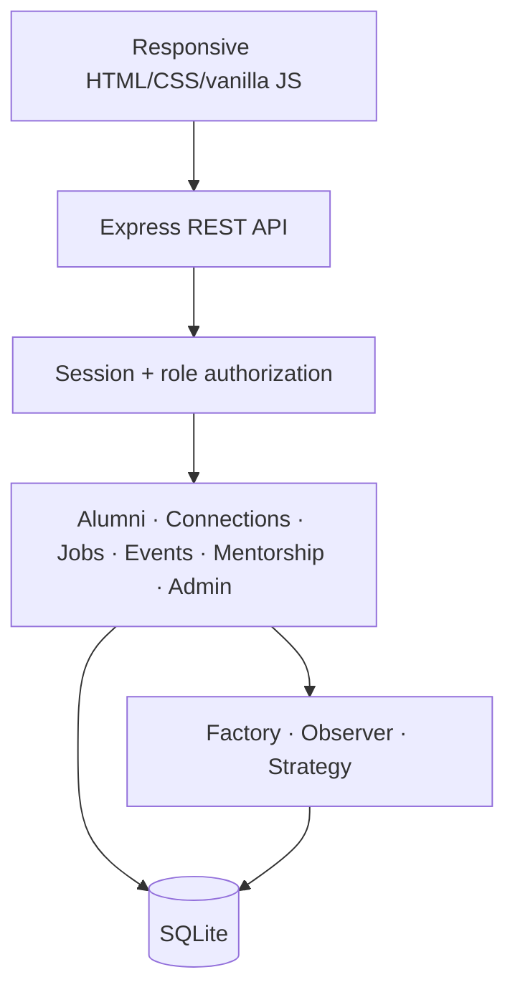
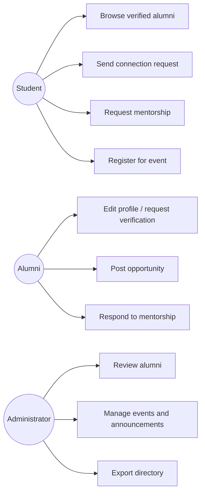
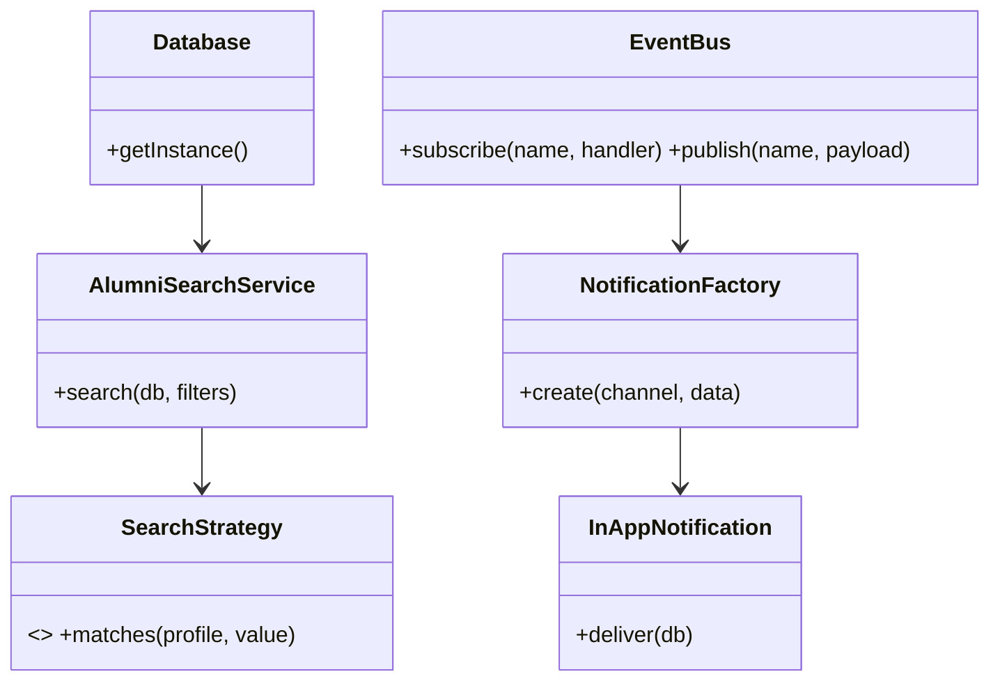
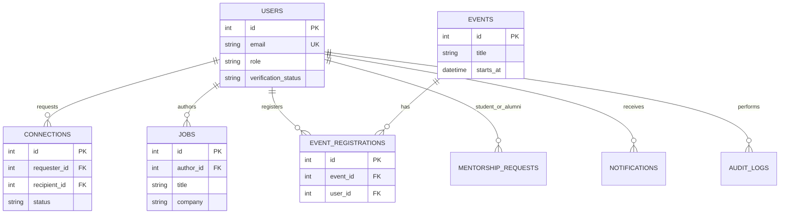

# Architecture

The application is a modular monolith. The browser calls REST endpoints over same-origin HTTP; Express provides session and role middleware, endpoint validation, and domain actions. SQLite is shared through the `Database` singleton. Notification subscribers react to domain events through an in-process event bus.

## UML source

### Use cases

### Class diagram

### ER diagram

