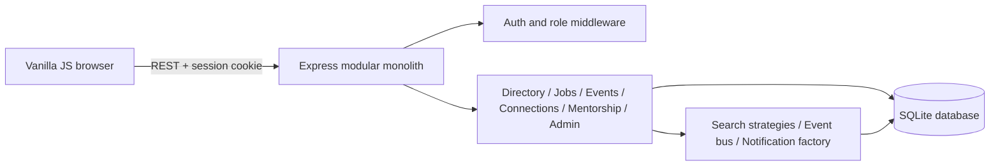

# System design

## Design sequence

This document follows the supplied system-design reference's structure: requirements, capacity assumptions, high-level architecture, core modules, data model, API, key workflows, deeper decisions, patterns, then reliability/scaling. The RideNow domain and its ride-hailing features are not reused.

## Requirements and capacity

The initial target is a single university community for a local project demonstration. No measured traffic requirement was supplied; as a modest planning assumption, a few thousand accounts and tens of concurrent demo users fit one Node process and SQLite. These are planning assumptions, not measured capacity claims. If the deployment grows, move to a managed relational database and persistent session storage after profiling.

## High-level architecture

## Core modules

The server entry configures middleware and routes. `src/db.js` owns the singleton SQLite manager, schema, and idempotent demo seed. Pattern modules isolate search behavior, event publication, and notification construction. `public/` holds a responsive client that calls the REST API. `docs/` records requirements and system decisions.

## Core workflows

Registration hashes the password, creates the role-constrained user, and starts a session. Alumni start pending; administrators alone transition verification state. A connection request stores a pending row and publishes an event; the in-app subscriber creates a recipient notification. Directory queries return verified profiles only. Event registration relies on a unique event/user constraint.

## Reliability and growth

SQLite foreign keys and uniqueness constraints protect relational integrity. Multi-step admin verification and audit writes execute in a transaction. Seed creation runs only for an empty database. Backups and migration tooling should be added before a real deployment. Current session storage is process memory and will not survive restarts or multiple server replicas.
